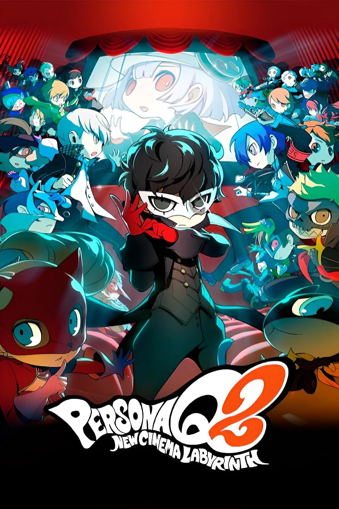

<p align="center">
  
</p>

<p align="center">
  <a href="SUIVI.md"></a>
  <a href="https://discord.gg/s6CRadvPa3"></a>
  
  
</p>



**Fan-traduction française de *Persona Q2: New Cinema Labyrinth*** sur
Nintendo 3DS (version européenne, `CTR-P-AQ2P`).

Sorti en Europe en 2019 uniquement en anglais, le dernier grand crossover
de la série réunit les héros de *Persona 3*, *Persona 4* et *Persona 5*.
Ce projet vise une version **complète, jouable et écrite en vrai français**,
accents compris.

Un après-midi comme les autres, les Voleurs Fantômes s'endorment… et se
réveillent dans un mystérieux cinéma dont ils ne peuvent plus sortir.
Chaque séance les plonge dans un film qui est aussi un labyrinthe. Ils ne
sont pas seuls : d'autres porteurs de Persona, venus d'autres villes et
d'autres années, sont pris au piège avec eux.

Le projet a été **lancé par [Tyron26](https://github.com/tyron2611)**, qui a
traduit les premières scènes et percé les premiers secrets du jeu, et il est
mené avec la communauté du **[Grimoire du Cœur](https://github.com/Grimoire-du-Coeur)**.

<br clear="right">


## Avancement

<!-- avancement:debut -->
```text
Histoire       ░░░░░░░░░░░░░░░░░░░░░░░░    0 %        90 / 16 447 textes
Donjons        ░░░░░░░░░░░░░░░░░░░░░░░░    0 %         0 / 4 330 textes
Combat         █░░░░░░░░░░░░░░░░░░░░░░░    2 %        72 / 3 246 textes
Système        ░░░░░░░░░░░░░░░░░░░░░░░░    0 %         3 / 4 922 textes
Noms           ░░░░░░░░░░░░░░░░░░░░░░░░    0 %         0 / 238 textes

Total          ░░░░░░░░░░░░░░░░░░░░░░░░    0 %       165 / 29 183 textes
               1 540 mots traduits sur 310 375
```
<!-- avancement:fin -->

Le détail par dossier est dans **[SUIVI.md](SUIVI.md)**, mis à jour
automatiquement à chaque fusion. Ce qui reste à faire, et dans quel ordre,
est écrit dans la **[feuille de route](docs/FEUILLE_DE_ROUTE.md)**.

> [!NOTE]
> Une ligne pas encore traduite s'affiche en anglais. Le patch reste donc
> jouable de bout en bout à chaque étape, et chaque ligne traduite se voit
> tout de suite en jeu.


## Participer

Toute aide est la bienvenue : traduction, relecture, tests en jeu.

1. **Rejoins le [Discord du Grimoire du Cœur](https://discord.gg/s6CRadvPa3)** :
   c'est là qu'on se répartit les fichiers, pour que deux personnes ne
   traduisent pas la même scène.
2. **Lis le [guide de contribution](CONTRIBUTING.md)**, puis le
   **[Dictionnaire](docs/Dictionnaire.md)** : un terme se traduit toujours de
   la même façon d'un bout à l'autre du jeu.
3. **Ouvre un fichier de [`trad/`](trad/)** et remplis les champs `"fr"`.
   Rien d'autre à toucher, et rien à installer : ça marche aussi depuis le
   navigateur de GitHub.

```json
{
  "id": "MSG_002",
  "locuteur": "Morgana",
  "en": "Geez, you're finally awake. Class has{SAUT}been over for a while now...",
  "fr": "Pfiou, tu es enfin réveillé. Les{SAUT}cours sont finis depuis un moment..."
}
```

Chaque proposition est vérifiée automatiquement : balises, caractères
disponibles dans la police du jeu, largeur des lignes en pixels, respect
du dictionnaire, typographie. Les remarques s'affichent directement sur
les lignes de la Pull Request.


## Organisation du dépôt

```text
trad/          ← le texte à traduire, en JSON (c'est le seul dossier à modifier)
  histoire/      scènes, cinéma, fiches de présentation des personnages
  donjons/       remarques du groupe dans les labyrinthes, quêtes
  combat/        dialogues de combat, messages de résultats
  systeme/       aides des objets et compétences, boutiques, camp, tutoriel
  noms/          noms des personnages qui parlent (une seule traduction pour tout le jeu)
outils/        ← extraire, valider, injecter, importer, suivi
police/        ← accents de la police du jeu, largeur des caractères
docs/          ← dictionnaire, feuille de route, notes techniques, guide pour jouer
```

Le texte est sorti du jeu par `outils/extraire.py`, et remis dedans par
`outils/injecter.py` au moment du build. Les codes techniques (portrait,
voix, attente) sont cachés : le traducteur ne voit que ce qui se traduit.
Les détails sont dans [docs/TECHNIQUE.md](docs/TECHNIQUE.md).


## Construire et tester

> [!IMPORTANT]
> Il faut **ta propre copie** de *Persona Q2: New Cinema Labyrinth* en version
> **européenne**, décryptée (`.3ds`, title ID `00040000001D7600`). Ce dépôt ne
> contient et ne télécharge aucune donnée du jeu.

```powershell
git clone https://github.com/Grimoire-du-Coeur/PQ2-FR-3DS.git
cd PQ2-FR-3DS
python outils/injecter.py "C:\chemin\vers\Persona Q2 (Europe).3ds" --azahar
```

Lance ensuite le jeu dans [Azahar](https://azahar-emu.org/) : le texte
français est chargé automatiquement. Le premier build copie l'archive du
jeu une fois (2,8 Go) ; les suivants prennent quelques secondes. Pour une
vraie console avec Luma3DS, et pour décrypter son jeu, tout est expliqué
dans **[docs/JOUER.md](docs/JOUER.md)**. Il faut Python 3.10 ou plus récent.

Les versions publiques seront distribuées uniquement sous forme de
**patch**, à appliquer sur sa propre copie du jeu.


## Équipe

<table>
  <tr>
    <td align="center" width="20%"><a href="https://github.com/tyron2611"><br><b>Tyron26</b></a><br><sub>à l'origine du projet<br>premières traductions</sub></td>
    <td align="center" width="20%"><a href="https://github.com/CodeByHaamza"><br><b>Hamza</b></a><br><sub>traduction<br>& outils</sub></td>
    <td align="center" width="20%"><a href="https://github.com/vikmorp"><br><b>Vikmor</b></a><br><sub>fondateur<br>du Grimoire du Cœur</sub></td>
    <td align="center" width="20%"><a href="https://github.com/chenetulipe"><br><b>chene</b></a><br><sub>traduction<br>& outils</sub></td>
    <td align="center" width="20%"><a href="https://github.com/Garloulou"><br><b>Garloulou</b></a><br><sub>support<br>& intégration</sub></td>
  </tr>
</table>

Merci aux auteurs des outils qui ont ouvert la voie :
[PersonaEditor](https://github.com/Meloman19/PersonaEditor) de Meloman19,
[Kuriimu2](https://github.com/FanTranslatorsInternational/Kuriimu2),
[Atlus Script Tools](https://github.com/tge-was-taken/Atlus-Script-Tools) de TGE,
et à l'équipe d'[Azahar](https://azahar-emu.org/).


## Mentions légales

Ce dépôt ne distribue **aucun contenu appartenant à Atlus** : ni image du
jeu, ni archive, ni musique, ni vidéo, ni police ou graphisme d'origine.
Il contient le texte de la traduction, avec l'anglais du jeu comme
référence pour les traducteurs, les outils et la documentation. Un
contrôle automatique refuse tout fichier de jeu.

*Persona Q2: New Cinema Labyrinth* et tous les éléments qui s'y rattachent
appartiennent à **Atlus / SEGA**. Ce projet est gratuit, réalisé par des
fans, sans aucun but commercial.

- Outils de ce dépôt : licence [MIT](LICENSE).
- Texte français (`trad/`) : licence [CC BY-NC-SA 4.0](LICENSE).
